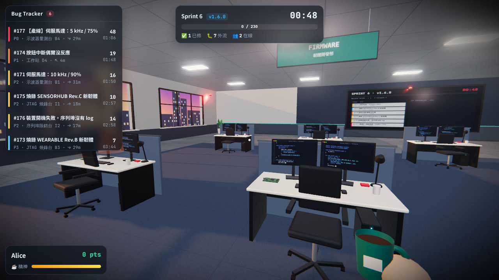

# RDSIM · 韌體工程師模擬器

多人連線、第一人稱的韌體工程師模擬網頁遊戲。你和同事在同一間研發實驗室裡，要在 6 分鐘的 Sprint 內修完不斷冒出來的 bug，把 `v1.x.0` 準時出貨。

> A multiplayer, first-person firmware-engineer simulator that runs in the browser (Three.js + WebSocket).



## 快速開始

```bash
npm install
npm start            # http://localhost:3000
```

在區網裡的其他電腦打開 `http://<你的IP>:3000`，就能一起上班。可以用 `PORT=8080 npm start` 換埠號。

## 玩法

| 按鍵 | 動作 |
| --- | --- |
| `W` `A` `S` `D` | 移動（`Shift` 跑步、`Space` 跳） |
| 滑鼠 | 視角（點畫面鎖定游標） |
| `E` | 和工作台／咖啡機互動 |
| `Enter` / `T` | 聊天 |
| `Tab` | 排行榜與發佈紀錄 |
| `1`–`4` | 表情 👍 😂 🔥 🙏 |
| `Esc` | 離開座位／暫停 |

- 有 bug 的工作台上方會浮著發光的水晶，顏色代表嚴重度：🔴 P0 產線停擺 · 🟠 P1 · 🟡 P2 · 🔵 P3。
- 走到工作台前按 `E` 認領任務，一個任務同時只能有一位工程師處理。
- 修好會增加 Sprint 進度；任務逾時就會「流到客戶端」，扣進度。
- **結對加成**：同事解題時站在旁邊，解題者得分 ×1.5，旁邊的人也分到 25%。
- 隨機發生 **🚨 產線緊急事件**（P0），整間實驗室會亮起紅色警示燈。
- 精神值會隨時間下降，太累會走得慢、畫面變灰 —— 去咖啡補給站喝一杯。
- Sprint 結束時進度達標就出貨成功 🚀，否則延期 💥；15 秒後開始下一個 Sprint。

### 五種任務

| 任務 | 工作台 | 內容 |
| --- | --- | --- |
| Code Review / 修 Bug | 工作站 | 在 C 程式碼中找出有 bug 的那一行（缺 `volatile`、off-by-one、ISR 裡呼叫 `printf`、race condition…） |
| 暫存器設定 | 工作站 | 依 datasheet 需求切換 16 個位元，寫出正確的暫存器值（USART/SPI/TIM/GPIO） |
| PWM 波形調校 | 示波器量測台 | 設定 PSC / ARR / CCR，讓示波器上的波形符合目標頻率與 duty |
| UART 開機 log 除錯 | 序列埠除錯台 | 選對 baud rate 讓亂碼變成可讀的 log，再找出故障原因 |
| 韌體燒錄 | JTAG 燒錄台 | 從一堆映像檔中挑出符合 Rev / MCU / Bootloader 的 `.hex`，並依正確順序燒錄 |

答案都在伺服器端驗證，解答不會傳給瀏覽器（UART 任務除外，畫面需要知道正確 baud 才能顯示可讀的 log）。

## 架構

```
server/index.js     HTTP 靜態檔 + WebSocket，權威遊戲狀態（Sprint、任務、玩家、聊天）
server/puzzles.js   五種任務的題目產生器與答案驗證
shared/layout.js    伺服器與瀏覽器共用的實驗室配置（工作台位置、嚴重度、任務類型）
public/js/world.js  以程式產生的 3D 實驗室：建築、家具、儀器、燈光、看板
public/js/textures.js  Canvas 程序貼圖（地板、PCB、程式碼螢幕、示波器、天際線…）
public/js/player.js 第一人稱控制器（Pointer Lock、碰撞、頭部晃動、觸控）
public/js/avatars.js 其他玩家的角色模型、名牌、表情泡泡
public/js/tasks.js  五種任務的互動介面
public/js/main.js   渲染管線、網路事件、HUD、互動與主迴圈
```

畫面：ACES tone mapping、PCF 軟陰影（夕陽從西側窗戶照進來）、RoomEnvironment IBL 反射、UnrealBloom、自訂調色／暗角／色差／底片顆粒 shader。所有貼圖都由 Canvas 即時產生，沒有外部美術資源。暫停選單可以關閉高畫質模式；網址加上 `?lq` 直接以低畫質啟動。

## 測試

```bash
npm test             # 題目可解性 + 兩個 WebSocket 客戶端的多人流程
npm run screenshot   # 需先 npm start；用無頭 Chromium 從多個角度截圖到 screenshots/
GALLERY=1 npm run screenshot   # 另外輸出五種任務介面的截圖
```
